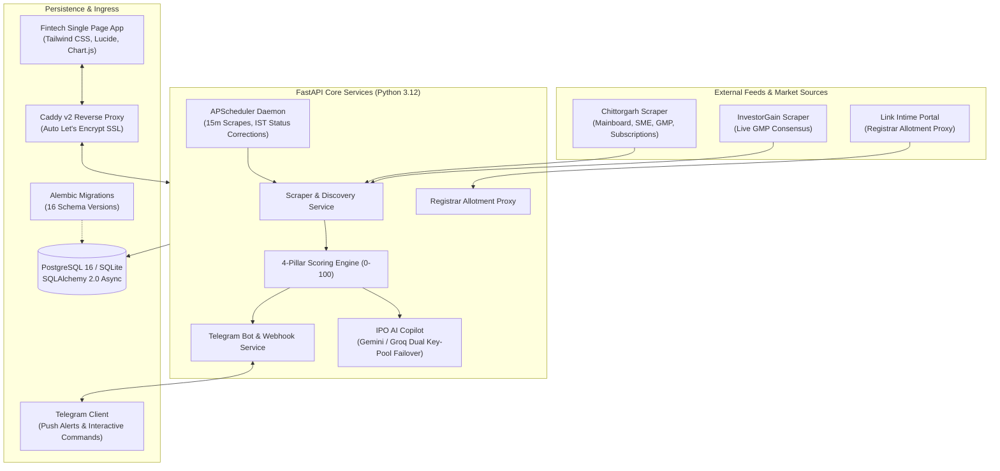

# IPO Pulse — Primary Market Intelligence Platform

[](https://python.org)
[](https://fastapi.tiangolo.com)
[](https://www.sqlalchemy.org)
[](https://www.postgresql.org)
[](https://www.docker.com)
[](LICENSE)

An asynchronous, full-stack Indian Primary Markets (**Mainboard & SME IPOs**) intelligence engine and registrar allotment tracking platform. Engineered with **FastAPI**, **SQLAlchemy 2.0 (`asyncpg` / `aiosqlite`)**, **Pydantic v2**, **APScheduler**, and a responsive dark-mode fintech Single Page Application (SPA).

The platform tracks Mainboard & SME IPOs, computes a 4-pillar algorithmic score (0–100), monitors live Grey Market Premium (GMP) consensus, queries Link Intime allotment status in real time, provides an IPO-specialized **AI Copilot** (Gemini & Groq failover), and broadcasts instant **Telegram Bot** alerts.

---

## Architecture Overview



---

## Core Capabilities

### 1. IPO Intelligence & Discovery Engine
* **Comprehensive Market Coverage**: Live tracking of Indian Mainboard and SME (BSE SME / NSE Emerge) issues.
* **Polite Scraper Daemon**: Scrapes upcoming and active IPO catalogs every 15 minutes with jittered delays (2–3s) and in-memory caching to avoid IP throttling.
* **Deterministic IST Date Status Pipeline**: Enforces Indian Standard Time (IST) calendar transitions:
  * `UPCOMING`: Scheduled prior to bidding start.
  * `LIVE`: Active bidding window (runs until 5:00 PM IST on issue close date).
  * `CLOSED`: Bidding ended, awaiting allotment and listing.
  * `LISTED`: Shares actively trading on secondary exchanges.
  * Issues with unannounced dates are tagged with `dates_tba=True`.
* **Consensus GMP Aggregator**: Weighted consensus Grey Market Premium aggregated across market data feeds.
* **Direct Broker Deep Links**: One-click `HTTP 307` redirect button linking directly to the official broker application portal.

### 2. Multi-Pillar Quantitative Scoring Model (0–100)
Every IPO is algorithmically evaluated across four objective pillars to determine an actionable investment conviction rating:

| Dimension | Weight | Evaluation Criteria |
| :--- | :---: | :--- |
| **Grey Market Premium (GMP)** | **35 pts** | Percentage gain over issue price cap. $\ge 50\%$ gets 35 pts; $30-50\%$ gets $28-35$ pts; $15-30\%$ gets $18-28$ pts; $<0\%$ gets 0 pts. |
| **Subscription Demand** | **30 pts** | Institutional backing (QIB up to 16 pts), Retail participation (up to 6 pts), and Total oversubscription multiple (up to 8 pts). |
| **Valuation & Fundamentals** | **20 pts** | IPO P/E relative to Industry Average P/E (discount vs premium, up to 12 pts) and Return on Net Worth (RoNW %, up to 8 pts). |
| **Issue Structure & Size** | **15 pts** | Fresh issue ratio (growth capital vs promoter OFS cashing out, up to 10 pts) and market liquidity comfort (up to 5 pts). |

* **Rating Conviction Tiers**:
  * **`STRONG APPLY`**: Score $\ge 75.0$
  * **`APPLY`**: $60.0 \le \text{Score} < 75.0$
  * **`NEUTRAL`**: $45.0 \le \text{Score} < 60.0$
  * **`AVOID`**: $\text{Score} < 45.0$
* **Automated Explainability**: Generates positive catalysts (e.g. robust institutional demand, attractive valuation) and warning signals (e.g. 100% OFS, negative GMP, high debt).

### 3. Registrar Allotment Status Proxy
* **Link Intime Real-Time Querying**: Direct proxy querying allotment status via PAN, Application Number, or DP ID / Client ID.
* **Standardized Status Normalization**: Normalizes varied registrar responses into uniform states: `ALLOTTED`, `NOT_ALLOTTED`, `NOT_FOUND`, or `PENDING`.
* **Automated Company Mapping**: Synchronizes registrar company identifiers with internal IPO master records.

### 4. IPO AI Copilot
* **Dual-LLM Engine with Key Pooling**: Primary integration with Google Gemini (`gemini-3.1-flash-lite`) and Groq (`openai/gpt-oss-120b`), backed by multi-key rotation and smart failover.
* **IPO-Specialized Grounding**: Direct access to live IPO database, GMP trends, subscription multiples, and registrar data. Strict guardrails against non-IPO queries.
* **Web Search Grounding**: Live search context retrieval for regulatory inquiries (e.g. current SEBI chairperson, official circulars).
* **Voice Read-Aloud**: Audio synthesizer integration for hands-free audio briefing in the frontend floating dock.

### 5. Automated Telegram Bot & Webhooks
* **Proactive Alerts**: Instantly notifies on high-conviction IPOs exceeding score and GMP thresholds (with Mainboard vs SME filter options).
* **Top Picks Daily Digest**: Automated summary sent to channels or private chats.
* **Interactive Bot Commands**:
  * `/start` or `/help` — Command reference and active status.
  * `/top` or `/best` — Current best IPOs to apply for.
  * `/ipo <name>` — Instant scorecard, GMP, and status lookup.
* **Security & Privacy**: Built-in log sanitization masking sensitive tokens and API keys.

---

## Complete API Reference

All application endpoints are versioned under `/api/v1`. Interactive documentation is available at `/docs` (Swagger UI) and `/redoc` (ReDoc).

### 1. Authentication (`/api/v1/auth`)
| Method | Endpoint | Description | Auth Required |
| :--- | :--- | :--- | :---: |
| `POST` | `/api/v1/auth/login` | Authenticate credentials and receive a JWT Bearer token (rate-limited). | No |
| `POST` | `/api/v1/auth/register` | Register a new user account with PBKDF2 salted password hashing. | No |
| `GET` | `/api/v1/auth/me` | Inspect current authenticated user profile. | Yes |
| `POST` | `/api/v1/auth/change-password` | Update account password for authenticated session. | Yes |
| `GET` | `/api/v1/auth/check-username` | Validate username availability in real time. | No |
| `POST` | `/api/v1/auth/forgot-password` | Request password reset token. | No |
| `POST` | `/api/v1/auth/reset-password-with-token` | Reset password using one-time token. | No |

### 2. IPO Catalog & Intelligence (`/api/v1/ipos`)
| Method | Endpoint | Description | Auth Required |
| :--- | :--- | :--- | :---: |
| `GET` | `/api/v1/ipos` | List all IPOs with filters (`status`, `ipo_type`, `recommendation`, `min_score`, `search`). | No |
| `POST` | `/api/v1/ipos` | Create an IPO master entry. | Yes |
| `GET` | `/api/v1/ipos/{id}` | Retrieve comprehensive profile, subscription history, and GMP snapshots. | No |
| `PUT` | `/api/v1/ipos/{id}` | Update an IPO record. | Yes |
| `DELETE` | `/api/v1/ipos/{id}` | Delete an IPO record. | Yes |
| `GET` | `/api/v1/ipos/symbol/{symbol}` | Query an IPO by ticker symbol. | No |
| `POST` | `/api/v1/ipos/{id}/subscriptions` | Append a subscription snapshot (`qib`, `nii`, `retail`, `total`). | Yes |
| `POST` | `/api/v1/ipos/{id}/gmp` | Append a GMP update (`gmp_amount`, `gmp_percentage`). | Yes |
| `GET` | `/api/v1/ipos/{id}/gmp/trend` | Retrieve historical GMP trend data. | No |
| `GET` | `/api/v1/ipos/{id}/score` | Retrieve composite score and individual pillar breakdowns. | No |
| `POST` | `/api/v1/ipos/{id}/score/recalculate` | Trigger on-demand score recalculation. | Yes |
| `GET` | `/api/v1/ipos/{id}/score/breakdown` | Detailed quantitative scoring factors and penalty analysis. | No |
| `POST` | `/api/v1/ipos/ask` | Query the IPO AI Copilot (Gemini & Groq failover with web grounding). | No |
| `GET` | `/api/v1/ipos/{id}/apply/angelone` | `HTTP 307` redirect to broker bidding portal by IPO ID. | No |
| `GET` | `/api/v1/ipos/symbol/{symbol}/apply/angelone` | `HTTP 307` redirect to broker bidding portal by ticker symbol. | No |

### 3. Registrar Allotment Status (`/api/v1/allotment`)
| Method | Endpoint | Description | Auth Required |
| :--- | :--- | :--- | :---: |
| `GET` | `/api/v1/allotment/ipos` | Index of active IPOs tracked for allotment status. | No |
| `GET` | `/api/v1/allotment/linkintime/companies` | List all IPOs currently available on Link Intime portal. | No |
| `POST` | `/api/v1/allotment/linkintime/check` | Query allotment status by `PAN`, `APP_NO`, or `DPID`. | No |
| `POST` | `/api/v1/allotment/linkintime/sync-mappings` | Sync registrar company identifiers to IPO master records. | Yes |
| `GET` | `/api/v1/allotment/linkintime/unmatched` | Inspect registrar companies with unmapped master entries. | Yes |

### 4. Scoring Methodology & Track Record (`/api/v1/scoring`)
| Method | Endpoint | Description | Auth Required |
| :--- | :--- | :--- | :---: |
| `GET` | `/api/v1/scoring/rules` | Inspect weights, pillar thresholds, and interpolation logic. | No |
| `POST` | `/api/v1/scoring/calculate` | Interactive what-if scoring calculator. | No |
| `GET` | `/api/v1/scoring/track-record` | Historical listing-day gain accuracy by recommendation tier. | No |

### 5. Scraper & Scheduler Controls (`/api/v1/scraper`)
| Method | Endpoint | Description | Auth Required |
| :--- | :--- | :--- | :---: |
| `POST` | `/api/v1/scraper/sync` | Trigger immediate market sync and score recalculation. | Yes |
| `POST` | `/api/v1/scraper/sync-details` | Trigger deep detail scraping from data sources. | Yes |
| `POST` | `/api/v1/scraper/seed` | Seed initial baseline IPO dataset (`ALLOW_SEED=1`). | Yes |
| `GET` | `/api/v1/scraper/status` | Inspect scheduler heartbeat, next run times, and sync freshness. | No |

### 6. Telegram Bot & Webhooks (`/api/v1/telegram`)
| Method | Endpoint | Description | Auth Required |
| :--- | :--- | :--- | :---: |
| `GET` | `/api/v1/telegram/status` | Inspect bot connection status, chat ID, and active filters. | No |
| `POST` | `/api/v1/telegram/test` | Dispatch a test message to the configured Telegram chat. | No |
| `POST` | `/api/v1/telegram/broadcast-best` | Scan and broadcast top-scoring IPO recommendations. | No |
| `POST` | `/api/v1/telegram/digest` | Dispatch Top Picks morning summary digest. | No |
| `POST` | `/api/v1/telegram/webhook/setup` | Register server URL with Telegram Webhook API. | No |
| `GET` | `/api/v1/telegram/webhook/info` | Inspect active Telegram webhook configuration. | No |
| `POST` | `/api/v1/telegram/webhook` | Ingress for Telegram interactive commands (`/start`, `/top`, `/ipo`). | No |

### 7. System & Health
| Method | Endpoint | Description | Auth Required |
| :--- | :--- | :--- | :---: |
| `GET` | `/` | Responsive Fintech Single Page Application. | No |
| `GET` | `/health` | Health check verifying database connectivity and service state. | No |

---

## Quickstart & Installation

### Option A: Docker Compose (Production Deployment)

Run the full production stack (FastAPI app, PostgreSQL 16 database, Caddy reverse proxy with automatic SSL):

```bash
# 1. Clone repository
git clone https://github.com/Chinmay468/IPO_PULSE.git
cd IPO_PULSE

# 2. Configure environment
cp .env.example .env
# Edit .env with your credentials

# 3. Launch stack
docker compose up -d --build
```

Access the services:
* **Web Application**: `https://your-domain` (or `http://localhost:8000`)
* **Interactive API Docs**: `http://localhost:8000/docs`
* **PostgreSQL Database**: `localhost:5432` (`db: ipo_db`)

---

### Option B: Local Development Setup

#### 1. Prerequisites
* Python 3.12+
* PostgreSQL 16 (or SQLite for lightweight local testing)

#### 2. Virtual Environment Setup
```bash
python -m venv .venv

# On Linux / macOS:
source .venv/bin/activate

# On Windows (PowerShell):
.venv\Scripts\Activate.ps1
```

#### 3. Install Dependencies
```bash
pip install --upgrade pip
pip install -r requirements.txt
```

#### 4. Configure Environment
```bash
cp .env.example .env
```

#### 5. Apply Database Migrations
```bash
alembic upgrade head
```

#### 6. Start Development Server
```bash
uvicorn app.main:app --host 0.0.0.0 --port 8000 --reload
```

---

## Testing & Quality Assurance

The test suite covers end-to-end IPO management, scoring algorithms, scraper normalization, Link Intime allotment proxying, auth rate limiting, and the IPO AI Copilot:

```bash
# Run full automated test suite
pytest -q
```

All 116 unit and integration tests run in under 35 seconds with zero external network dependencies (network calls are mocked).

---

## Database Migrations

Schema migrations are managed with **Alembic**. The version history spans 16 revisions:

* Revisions `001` through `015`: Schema evolution of core IPO, GMP, subscription, document, and registrar tables.
* Revision `016` (`016_remove_portfolio_and_mutual_funds.py`): Cleanly drops all legacy portfolio, mutual fund, price prediction, and technical diagnosis tables and enums.

To verify migration status:
```bash
alembic current
alembic check
```

---

## License

This project is licensed under the [MIT License](LICENSE).
